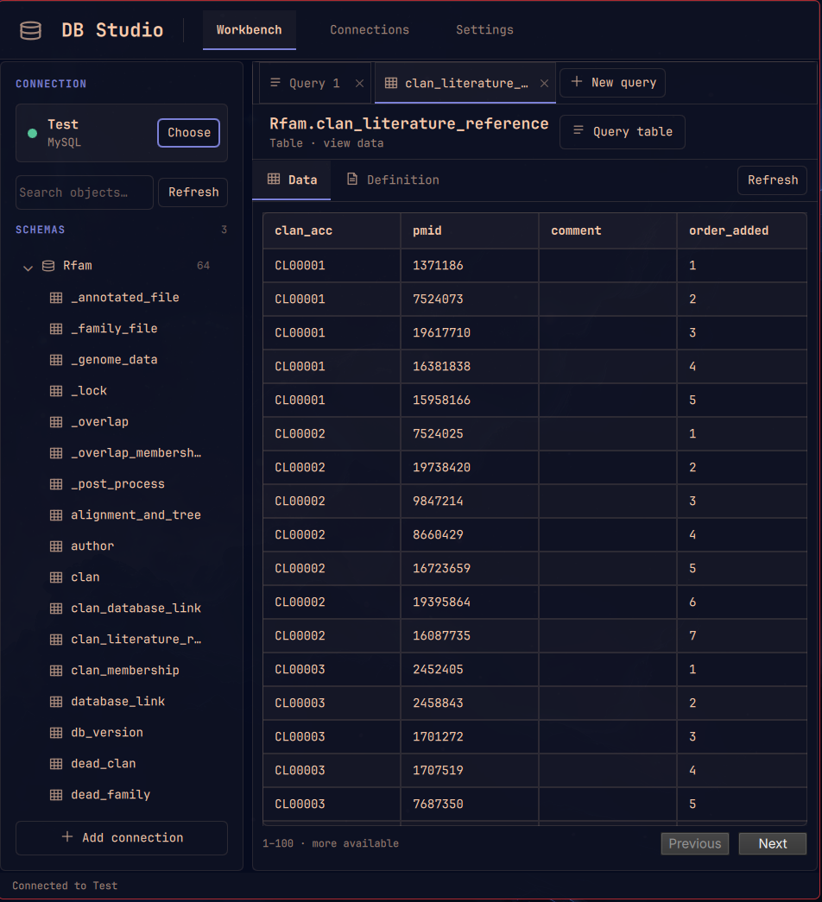
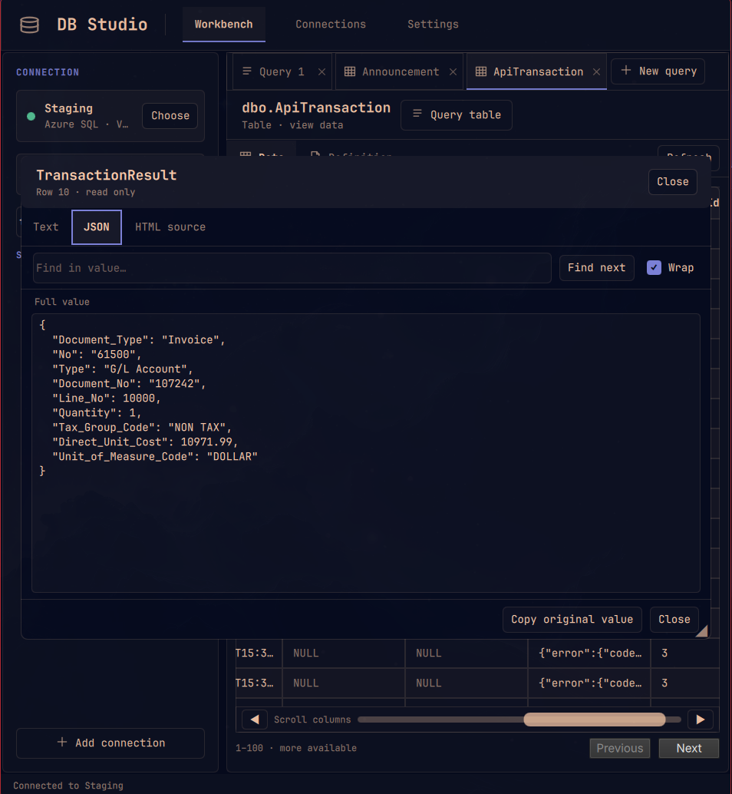

# DB Studio for Omarchy

**Browse SQL Server, Azure SQL, PostgreSQL, MySQL, and Cloudflare D1 databases from an Omarchy workspace.**

Choose a connection, explore its schemas, open a table or view, inspect its definition, and run SQL without leaving your flow. Keep multiple connection profiles and switch between them when your work moves to another server or database. One connection is active at a time.



## Explore your databases

- **Find what you need.** Search schemas, tables, and views from the sidebar. Use **Show → Tables only / Views only / All objects** to filter the browser; search and object counts follow the selected type. The selection stays in place through refreshes and database switches during the session. Empty schemas stay out of the way.
- **Inspect data and structure.** Open a table or view to page through rows, or see its columns, keys, and indexes in **Definition**.
- **Sort and filter rows.** Click a column header to sort, or use **Filter…** (`Ctrl+F` in a table tab) to search the full table before paging. Primary keys provide stable ordering when the data is unchanged.
- **Edit table rows.** On SQL Server, Azure SQL, PostgreSQL, and MySQL, use **F2**, **Edit row**, or a double-click to change ordinary text, numeric, and boolean fields in a primary-key table. Review the modified fields and choose **Save row** to save them together, with conflict detection. Keys, generated columns, complex types, views, and SQL query results remain read-only; use SQL for D1 changes.
- **Read individual values.** Select a cell, then press Enter or choose **View value** to open a resizable, read-only viewer. Search and wrap text, format valid JSON, or inspect HTML as source. Right-click a cell to copy its full value or column name.
- **Run SQL.** Work in multiple query tabs with dialect-aware highlighting and schema autocomplete. Use `Ctrl+Enter` to run selected SQL or the entire query, cancel a long-running query, and collapse or resize the SQL editor while keeping results visible. Set the query timeout from 5 to 1,000 seconds in **Settings** (30 seconds by default).
- **Keep SQL files handy.** Open and save `.sql` files, search SQL within a query tab, and review unsaved changes before closing a tab. Saving detects files changed outside DB Studio.
- **Draft or fix SQL with AI.** When Omarchy's default agent is Codex and its CLI is installed and signed in, **✦ Ask AI** appears beside **Run query**. Describe the query you want or ask for a repair, then review the suggested SQL before choosing **Use in editor**. DB Studio uses the current tab's SQL and its last query error as context. It never runs the suggestion automatically.
- **Connect coding agents.** Opt remembered profiles into local CLI and MCP access so agents can inspect schemas, read rows, and run SQL with the saved account's permissions. See [Local AI agent access](#local-ai-agent-access) for setup and consent details.
- **Compare SQL Server schemas.** Open **Schema diff**, choose source and target SQL Server or Azure SQL connections, then select the schemas, tables, and views to compare. Use Tables/Views group checkboxes, search, or select/clear the shown objects. Everything starts checked. Review the differences and generate a source-to-target `.sql` script to save or copy; DB Studio does not execute it.
- **Keep results manageable.** Queries and table pages start at 100 rows. Set a default from 1 to 1,000 in **Settings**; DB Studio caps rows delivered for a query even when its `SELECT` has no `LIMIT` or `TOP`. This is a default result size, not a database work or affected-row limit.
- **Move between databases.** On SQL Server and Azure SQL, click the current database in the sidebar to open a full-height picker. Search the list or enter a database name directly, then choose one to return to the schema browser. MySQL shows accessible databases in the schema tree. For PostgreSQL, connect to a specific database and browse its schemas.

### Work in smaller windows

The workbench supports windows down to 760 × 480. The schema browser starts hidden below 1,000 pixels wide; toggle it with **Show browser** or `Ctrl+B`. Query tabs contain only SQL and results; object details belong in table tabs. The SQL editor starts compact and the results take the remaining workspace. Choose **Hide SQL** / **Show SQL** (`Ctrl+Shift+E`) to collapse or restore the editor; Run and Cancel remain above it. Short windows automatically collapse the editor after a query completes unless you have explicitly chosen to keep it open. Drag the divider to resize SQL; the results keep a usable minimum height. Vertical scrolling stays at the visible edge even on wide tables; use Shift+wheel or the column slider to move horizontally.

Drag a column header’s right edge to resize it, or double-click the edge to fit the header and loaded values (up to the first 500 rows). Column widths stay with each tab and result shape during the session, including refreshes.

Navigate grid cells with arrows, Tab, Home/End, and Page Up/Down. `Ctrl+C` copies a value; `Ctrl+Shift+C` copies the row. **Copy results** copies the loaded rows and headers as tab-separated text for a spreadsheet; results containing shortened values require copying full values individually from the viewer. `Ctrl+W` closes a tab and `F5` runs the active query or refreshes the active table. The result count, duration, and row-limit status stay in the results header. Execution errors and statements without result columns open **Messages**, which is selectable and scrollable.

### Sort and filter table data

Click a sortable column header to cycle through ascending, descending, and default order. Sorting runs in the database. Primary-key columns provide the default order and break ties when sorting another column, so unchanged tables page consistently. Tables or views without a primary key cannot guarantee stable pagination. Concurrent inserts, deletes, or sort-key changes can still move rows between pages.

Choose **Filter…** (or `Ctrl+F` in a table tab), select a column and condition, and choose **Apply**. Filters search the full table before applying the page limit; they persist through paging, refresh, and value saves. Text filters treat `%`, `_`, and `[` literally and follow the database's case/collation rules. **Clear filter** restores the unfiltered table. Both sorting and filtering reset to the first page. Complex column types still require SQL.

### SQL highlighting and autocomplete

The SQL editor colors keywords, functions, strings, numbers, parameters, and comments for the active database dialect. Suggestions appear after two letters or a qualifier such as `dbo.` or `j.`; use `Ctrl+Space` to request them anywhere outside a string or comment. Use Up/Down to choose, Tab or Enter to insert, Escape to dismiss, or click a suggestion. `Ctrl+Enter` continues to run SQL. Completion is one undo step.

Suggestions include keywords, functions, schemas, tables, views, and columns from tables referenced by the current statement, including aliases and joins. For example, `SELECT p. FROM public.people p` offers columns from `people`. Table and column names are quoted for the active dialect. Column definitions load on demand through read-only metadata calls and are cached until schema refresh or a database/connection change. Unavailable metadata does not block editing or keyword completion. This is lightweight completion: CTE/derived-table outputs, temporary objects, ambiguous unqualified tables, and cross-database references are not inferred.

### Open, save, and search SQL

Use **Open SQL** (`Ctrl+O`), **Save** (`Ctrl+S`), and **Save as** (`Ctrl+Shift+S`) for UTF-8 `.sql` files. Files use the editor's 200,000-character / 10,000-line limit. An asterisk marks unsaved changes; closing a query tab offers Save, Discard, or Cancel. Saving detects a file changed outside DB Studio and asks you to reopen it or use Save as. Saving SQL never executes it. Tab headers scroll horizontally and keep the active tab visible; file buttons remain available beside the tabs.

In a query tab, `Ctrl+F` searches the SQL text. Use Enter / `F3` for the next match and `Shift+F3` for the previous one, wrapping at the ends. Search is literal and case-insensitive. Escape closes the search bar. `Ctrl+Shift+F` opens schema/object search.

### Inspect a cell value

Open a cell to read long text, formatted JSON, or HTML source. Search within the value and copy the original contents from the read-only viewer.



| Database | Connection and browsing |
| --- | --- |
| SQL Server | SQL username/password; browse the current database and switch to other accessible databases. |
| Azure SQL | SQL username/password with encrypted, validated connections; browse and switch databases your account can access. |
| MySQL | Connection URL, driver string, or form fields; browse accessible databases in the sidebar. An empty password is supported. |
| PostgreSQL | Connection URL or form fields; browse schemas in the connected database. Use another profile to connect to another database. |
| Cloudflare D1 | Account ID, Database ID, and API token over verified HTTPS; browse tables and views under `main`. Use a separate profile for each database. |

### Cloudflare D1

Choose **Cloudflare D1** in **Add connection**, enter your Cloudflare Account ID (32 characters), D1 Database ID (UUID), and an API token scoped to that account. Find the IDs on your database's page in the Cloudflare dashboard. Give the token **Account → D1 → Read** for browsing or **D1 → Write** to run SQL changes. Remembered profiles store the token and IDs together in the system keyring; only the profile name, type, opaque profile ID, and AI consent setting go in the local profile file.

D1 supports table/view browsing, column and index definitions, server-side sorting and filters, paged rows, SQLite SQL highlighting/completion, SQL files, and the existing opt-in AI/MCP/CLI features. Use SQL to change values or schema; D1 inline grid editing and schema diff are unavailable. DB Studio does not provision or delete Cloudflare database resources.

The result limit caps displayed rows after Cloudflare executes the SQL and returns its response; it does not limit billed rows scanned or SQL changes. Add `LIMIT` to large reads. HTTP responses over 32 MB fail with an instruction to narrow the query. Multiple statements are sent together and all execute, while only the first result set is displayed. Cancel or timeout stops waiting locally; it cannot guarantee Cloudflare stopped or rolled back a submitted statement. Requests are never retried automatically.

**Durable Objects:** remote SQLite or key-value storage has no direct external SQL API like D1. Access requires application code in the owning Durable Object and a Worker that routes to it. DB Studio does not currently connect to Durable Object storage. See Cloudflare's [storage access documentation](https://developers.cloudflare.com/durable-objects/best-practices/access-durable-objects-storage/) and [D1 SQL API](https://developers.cloudflare.com/api/resources/d1/subresources/database/methods/raw/).

## Requirements

- Omarchy with the Quickshell plugin system.
- Node.js 20 or newer and npm. The setup script installs npm and its Node.js dependency through Omarchy if needed.
- `flock` (util-linux) for serializing agent requests to the same connection profile.
- A Secret Service compatible desktop keyring and `secret-tool` if you want to remember connections. Without a usable keyring, connections work for the current DB Studio session only.
- For AI query drafting, an Omarchy default coding agent set to Codex with an installed, signed-in Codex CLI. Other Omarchy agents are not supported by the in-panel AI action yet; the button stays hidden for them.

## AI query context

AI drafting sends your request, current SQL, last query error, database dialect, and relevant schema metadata to the selected Codex provider. DB Studio first sends a compact catalog of table and view names (up to 18,000 characters), then sends column names and types for at most eight relevant objects (up to 14,000 characters). The prompt excludes connection strings, passwords, row values, column defaults, and indexes. If the catalog is too large or the needed columns cannot be read, the assistant may ask for a more specific request rather than guessing.

DB Studio checks the Omarchy default agent and `codex login status` when the panel opens. If Codex is absent or signed out, **Ask AI** stays hidden; database browsing and SQL queries still work. The AI action runs `codex exec` in noninteractive, ephemeral, read-only mode. Its draft replaces the open query tab only after you choose **Use in editor**; **Run query** remains a separate action.

## SQL Server schema diff

Select two different SQL Server or Azure SQL connection profiles, explicitly choosing the source and target. DB Studio reads object names and lightweight view dependency metadata from both databases, then reads detailed definitions only for checked source objects and their matching targets. Matching uses the same schema and object name; table column order and existing-table index differences are ignored. Target-only objects and columns are reported and left untouched.

The comparison scope supports Tables and Views group checkboxes, per-schema and per-object selection, expand/collapse, and search by schema or object name. A dash in a checkbox means that some children are selected. **Select all / Clear all** affects the whole scope; **Select shown / Clear shown** affects search matches, including matches in collapsed schemas. At least one object must be selected. Procedures, functions, and other object types are not compared.

Results are grouped as **Missing in target** and **Different in target**, with tables before views and names sorted alphabetically. Every difference starts checked. Choose Tables or Views across the results, select individual objects or visible groups, or use **Select all / Clear all**. Search and filter by type or status; hidden selections remain included. Select a row (or focus it and press Enter) to inspect its column or view definition differences and proposed SQL. Space toggles a focused object's inclusion. **Generate script** shows the selected count and includes only checked differences. The target-only list is available separately for reference.

**Script options** controls optional indexes, CHECK constraints, and foreign keys on new tables. Columns, defaults, primary keys, and unique constraints remain included. These options do not add comparison of existing-table indexes or constraints. Options also apply to individual SQL previews. Returning to script scope keeps selections; changing selection or options invalidates the previous script.

The generated script creates missing schemas, ordinary tables with their defaults, keys, checks, foreign keys, and supported indexes, and missing views. For existing tables it adds columns and scripts simple type widening or nullability loosening; changed views receive `ALTER VIEW`. Changes that need a rebuild, could lose data, have blocking dependencies, or use unsupported table features are listed as manual work in an **incomplete** script. Known manual changes are flagged in the results and preview.

On SQL Server and Azure SQL, **Refresh dependent target views** adds `sys.sp_refreshview` for affected existing non-schema-bound views, including unchecked views and views outside the comparison scope. It preserves their target definitions and orders nested refreshes before views that consume their updated metadata. Selected view definition changes use CREATE/ALTER instead of an additional refresh. Schema-bound column dependencies block automatic column alteration and require manual review. Turning refresh off lists required refreshes as manual work. Dependency discovery follows visible local catalog dependencies; cross-database, cross-server, and hidden metadata dependencies need separate review. The script contains no `DROP` statements. DB Studio never executes it or copies row data. Review the saved `.sql` file and run it with a SQL Server script client against the named target database when ready.

## Local AI agent access

DB Studio includes a local CLI and MCP server so coding agents can inspect schemas, browse tables, and run SQL through remembered connection profiles. This is separate from the in-panel **Ask AI** drafting action. Agent access is off for every profile until you edit it, keep **Remember connection** on, and check **Allow AI agents to use this connection**. The connection list shows **AI access on** for enabled profiles. Duplicates start with access off. Turning the setting off prevents subsequent DB Studio CLI and MCP requests from opening that profile; an in-flight query may finish.

When the CLI or MCP connection list is empty, an agent should stop and tell you to open DB Studio and enable AI access on a remembered connection. It should not offer to change the setting, inspect disabled profiles, or open a connection through the raw worker. Enabling access is your action in the DB Studio interface.

Omarchy teaches its coding agents about the desktop through a `SKILL.md` directory linked into each agent's skill location. DB Studio's setup uses the same mechanism for its [DB Studio skill](skills/db-studio/SKILL.md): it links the skill into Codex, Claude, Pi, and Hermes skill directories. The agent loads the skill when a database task matches its description, or you can invoke it directly as `$db-studio` in Codex or `/db-studio` in Claude. The skill teaches tool names and discovery steps; the MCP server or CLI provides live database access. Restart an existing agent session if the new skill does not appear.

The consent text in the connection form explains the data flow: an agent can run SQL with the saved account's database permissions, including changes if allowed, and query results may be sent to its AI provider. DB Studio tool responses omit keyring credentials. An agent with shell access under your user account can access local files and may access the same keyring; the profile setting is a cooperative control, not an isolation boundary. Use a read-only database account if you want to prevent changes. Session-only profiles are unavailable because a separate agent process cannot reopen them.

Run the CLI after setup:

```bash
db-studio profiles
db-studio schemas --profile "My database"
db-studio objects --profile "My database" --schema public
db-studio describe --profile "My database" --schema public --name users
db-studio rows --profile "My database" --schema public --name users --limit 20
db-studio query --profile "My database" --sql 'SELECT COUNT(*) FROM users'
```

The command prints JSON to stdout. Use `db-studio query --profile "My database" --file query.sql` for a SQL file, or `--file -` for stdin. SQL input is limited to 200 KB. Omit `--limit` (or the MCP `limit` argument) to use the app's saved default result limit; an explicit value overrides it, up to 1,000 rows. The cap limits returned rows, not server work or rows changed by SQL. Agent calls for the same profile run one at a time and wait up to 30 seconds for a busy connection. MCP cancellation requests stop an active query when the database driver supports cancellation. Large cell values appear as previews with `truncatedCells` metadata; the short-lived cell handles are not exposed after the CLI or MCP call closes its connection.

To connect an Omarchy agent, point its local stdio MCP configuration at `node $HOME/.config/omarchy/plugins/andean-bridge.db-browser/backend/mcp.mjs`. For example:

```bash
codex mcp add db-studio -- node "$HOME/.config/omarchy/plugins/andean-bridge.db-browser/backend/mcp.mjs"
claude mcp add --scope user db-studio -- node "$HOME/.config/omarchy/plugins/andean-bridge.db-browser/backend/mcp.mjs"
gemini mcp add --scope user db-studio node "$HOME/.config/omarchy/plugins/andean-bridge.db-browser/backend/mcp.mjs"
```

Other MCP clients can use the same command and absolute path. DB Studio exposes `list_connections`, `list_schemas`, `list_objects`, `describe_table`, `read_rows`, and `run_query`. Each client starts its own local server process. The Omarchy agent launcher does not configure MCP servers on behalf of those clients.

For OpenCode, add a local server under `mcp` in `~/.config/opencode/opencode.json`, using an absolute path to `backend/mcp.mjs`:

```json
{
  "mcp": {
    "db-studio": {
      "type": "local",
      "command": ["node", "/home/YOUR_USER/.config/omarchy/plugins/andean-bridge.db-browser/backend/mcp.mjs"],
      "enabled": true
    }
  }
}
```

Gemini CLI suppresses MCP servers in folders it has not been asked to trust. Complete its normal workspace trust and authentication prompts when launching it. Any Omarchy agent with shell access can also use the `db-studio` CLI directly.

## Install

**Marketplace availability: Manual setup.** Omarchy installs the plugin source but does not run setup scripts. Run the second command below to install DB Studio's database drivers and launcher. The marketplace's **Snapshot verified** status covers the listed source commit; it does not remove this setup step.

Run these two commands in a terminal:

```bash
omarchy plugin add https://github.com/Andean-Bridge/omarchy-db-browser.git --enable
bash "$HOME/.config/omarchy/plugins/andean-bridge.db-browser/setup.sh"
```

The setup script installs npm and Node.js if needed, installs the locked database drivers and MCP server with `npm ci --omit=dev --no-bin-links`, adds the app-launcher entry, icon, `~/.local/bin/db-studio` command, and agent skill links, then opens DB Studio. Run it again after an update that changes the Node dependencies. `--no-bin-links` avoids symlinks inside the plugin that the validator rejects.

## Remove

```bash
bash "$HOME/.config/omarchy/plugins/andean-bridge.db-browser/uninstall.sh"
omarchy plugin remove andean-bridge.db-browser
```

Run the cleanup script before removing the plugin. It removes only launcher files matching this plugin and links pointing into this installation; it preserves unrelated files, saved connection profiles, and keyring secrets.

## Connection profiles and secrets

Create a named connection by pasting a connection string or filling in the fields. The SQL Server and Azure SQL drivers accept ADO-style strings; MySQL accepts a URL or driver string; PostgreSQL accepts a `postgres://` or `postgresql://` URL. Cloudflare D1 uses Account ID, Database ID, and API token fields. In **Connections**, you can duplicate a saved or session-only profile.

Selecting **Remember connection** stores the **entire connection string** in the desktop keyring as one secret. For connections entered through fields, DB Studio stores one serialized connection definition there instead. The local profile file at `${XDG_CONFIG_HOME:-~/.config}/omarchy/db-browser/connections.json` contains only an opaque ID, display name, database type, and AI access consent setting, with private file permissions. The keyring provider controls encryption and unlocking; DB Studio does not implement its own encryption.

The edit form indicates when a secret is stored but does not reveal it. Leave the connection fields blank to keep the saved secret, or enter new details to replace it. If no usable keyring is available, DB Studio can keep a connection for the current session only. It does not automatically save query history or result data to disk. SQL is written to a local file only when you choose Save or Save as. Full values behind shortened grid previews are held temporarily in worker memory, with a 5 MB limit per value and a 20 MB total cache limit; they expire after five minutes or when the connection closes. If a value exceeds the limit or expires, the viewer labels the shortened value as a preview and disables full-value copy.

## V1 notes

- Table value editing requires a primary key and supports ordinary text, numeric, and boolean columns (up to 65,536 characters). MySQL editing requires InnoDB. Use **Edit row** (F2) to change multiple fields, then **Save row** to save them together. Cancel discards the changes. Only modified fields are sent, and every save checks the captured key and each changed cell’s original value in one transaction; a conflicting or missing row rolls back. Row snapshots expire after five minutes or when the connection closes. After a failed save, close the dialog and refresh before retrying. Insert/delete rows, editing keys, date/time, binary, JSON, and other complex columns still require SQL. The cell viewer remains read-only.
- SQL Server and Azure SQL use SQL username/password authentication. Integrated Security, named instances without a TCP port, and Microsoft Entra interactive authentication are not supported yet.
- The MySQL form allows a blank password. New field-based connections start with verified TLS; turn it off explicitly for a local server that does not support TLS. PostgreSQL URLs default to verified TLS, and MySQL URLs or driver strings default to verified TLS for non-local hosts. Use `sslmode=disable` or `ssl=false` in a pasted string only when plaintext is intended. Existing saved profiles with TLS disabled retain that choice; DB Studio marks unencrypted remote connections. Azure SQL always requires encryption and certificate validation.
- Switching SQL Server or Azure SQL databases lasts for the current connection. Reopening a saved profile returns to its original database. Some Azure SQL logins cannot list every database; you can enter an accessible name directly.
- Query results display only the first result set. The row cap limits data delivered to DB Studio, though the server may still do work before the stream is stopped. Table pages use primary-key ordering when column metadata is available, with primary-key tie-breakers for explicit sorts. Objects without a primary key have no guaranteed order; concurrent data changes can still move rows between pages.
- PostgreSQL can list objects the login cannot read. A `42501` error explains whether schema `USAGE` or table or view `SELECT` access is missing.

## Development

```bash
npm ci --no-bin-links
npm test
omarchy plugin validate .
/usr/lib/qt6/bin/qmllint -I "${OMARCHY_PATH:-/usr/share/omarchy}/shell" DbStudioPanel.qml DbGrid.qml
```

The schema diff and workbench native interaction tests run automatically in `npm test` when Quickshell is installed (otherwise they are skipped). They use isolated fixture metadata and never open a saved database connection. The grid interaction tests use Qt Quick Test with isolated style fixtures:

```bash
QT_QPA_PLATFORM=offscreen /usr/lib/qt6/bin/qmltestrunner -input test/qml -import test/qml/imports -o -,txt
```

Live connection checks require a reachable database and credentials; the repository's automated checks do not connect to user databases.

## License

[MIT](LICENSE). Copyright © 2026 Andean Bridge.
